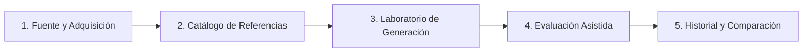

# Wheatley Voice Lab — Guía de Inicio Rápido (Quickstart)

Bienvenido a **Wheatley Voice Lab**. Esta guía práctica te llevará paso a paso desde la configuración de tus credenciales hasta la generación, evaluación y comparación de tus primeros samples de voz sintetizada del personaje Wheatley (_Portal 2_, español de España).

---

## 1. Configuración de Credenciales y Variables de Entorno

### 1.1 Configurar tu archivo `.env`

El proyecto utiliza [pydantic-settings](file:///c:/Users/veris/aponte.dev/VSProjects/wheatley-voice-lab/src/voice_lab/infrastructure/config/settings.py) para cargar la configuración de forma centralizada y segura.

> [!CAUTION]
> **Seguridad de tus Claves**:
> Nunca pegues tu API Key en `.env.example` (ese archivo está versionado en Git). Tu clave debe residir **únicamente en `.env`**, el cual está estrictamente excluido por `.gitignore`.

1. Abre el archivo `.env` en la raíz del proyecto.
2. Asegúrate de que contenga tu clave y el modelo que prefieras:

```env
# Clave generada en Google AI Studio (Gemini Pro / Flash)
GEMINI_API_KEY=

# Modelo recomendado: "gemini-2.5-flash" (rápido y multimodal) o "gemini-2.5-pro" (análisis prosódico profundo)
GEMINI_MODEL=gemini-2.5-flash

# Rutas locales y políticas
DATA_DIR=data
REFERENCE_DIR=data/references
GENERATED_DIR=data/generated
EVALUATION_DIR=data/evaluations
SOURCE_BASE_URL=https://theportalwiki.com/wiki/Wheatley_voice_lines/es
HTTP_TIMEOUT_SECONDS=30
HTTP_REQUEST_DELAY_SECONDS=1.5
MAX_DOWNLOAD_BYTES=25000000
MAX_RETRIES=3
LOG_LEVEL=INFO
ALLOW_REFERENCE_EXTERNAL_EVAL=false
```

---

## 2. Ejecutar la Aplicación Web Interactiva (Gradio)

El laboratorio cuenta con un dashboard visual interactivo desarrollado en Gradio 6.30 con estética temática de Aperture Science:

```powershell
.\.venv\Scripts\python.exe scripts/run_app.py --host 127.0.0.1 --port 7860
```

Una vez iniciado, abre en tu navegador web:
👉 **[http://127.0.0.1:7860](http://127.0.0.1:7860)**

---

## 3. Flujo Paso a Paso para Generar tus Primeros Samples

El laboratorio está organizado en **5 pestañas de trabajo** que cubren el ciclo completo:



---

### Paso 1: Descargar Audios de Referencia de Wheatley

_(Puedes hacerlo desde la web o mediante CLI)_

#### Opción A: A través de la Interfaz Web (Pestaña 1: "Fuente y Adquisición")

1. Ve a la pestaña **1. Fuente y Adquisición**.
2. Verás el cuadro de estadísticas: 92 secciones y 823 líneas descubiertas en la wiki de Portal.
3. En el menú desplegable **"Sección de la Wiki"**, selecciona por ejemplo:
   `Capítulo 1: Cortesía (capitulo-1-despertares)`
4. Ajusta el **"Límite de Audios"** a `5`.
5. Haz clic en el botón azul: **⬇️ Iniciar Adquisición Controlada**.
6. El sistema descargará atómicamente los archivos en `data/references/` verificando su hash SHA-256.

#### Opción B: A través de la Línea de Comandos (CLI)

```powershell
# Descargar 5 audios del Capítulo 1
.\.venv\Scripts\python.exe scripts/acquire_references.py --section capitulo-1-despertares --limit 5
```

---

### Paso 2: Inspeccionar Acústicamente una Referencia

1. Ve a la pestaña **2. Catálogo de Referencias**.
2. En **"Filtrar por Sección"**, elige el capítulo descargado y selecciona uno de los audios en el selector desplegable.
3. Haz clic en **🔍 Inspeccionar Audio**.
4. Podrás:
   - **Escuchar el audio original** de doblaje en español en el reproductor HTML5.
   - **Ver la transcripción textual oficial**: Ej: _"¡Hola! ¿Hay alguien ahí fuera?"_.
   - **Examinar la ficha técnica**: Duración, Frecuencia de Muestreo (Hz), Nivel RMS, Pico dBFS y confirmación de ausencia de distorsión digital (_Clipping_).

---

### Paso 3: Sintetizar tus Primeras Frases de Voz

1. Ve a la pestaña **3. Laboratorio de Generación**.
2. En **"Texto a Sintetizar"**, introduce una frase emblemática, por ejemplo:
   > _"¡Menos mal que estás bien! Bueno, relativamente bien... considerando la caída."_
3. Selecciona un **Perfil Emocional Declarativo**:
   - `Conversacional`: Tono estándar, ritmo regular (`speed=1.00`, `exaggeration=0.25`).
   - `Entusiasmado`: Dinamismo alto, tempo acelerado (`speed=1.18`, `exaggeration=0.85`).
   - `Confundido`: Vacilaciones, mayor temperatura sonora (`speed=0.92`, `temperature=0.90`).
   - `Enfadado`: Articulación firme y contundente (`cfg_weight=0.85`, `speed=1.12`).
   - `Nervioso`: Pánico acelerado, cadencia rápida (`speed=1.28`, `exaggeration=0.90`).
   - `Sarcástico`: Cadencia pausada, ironía condescendiente (`speed=0.86`, `exaggeration=0.70`).

   _(Al cambiar de perfil, los sliders de velocidad, exageración, temperatura y peso CFG se actualizarán automáticamente a los valores óptimos validados)._

4. **(Opcional) Clonación / Prompt de Voz**:
   - En el acordeón _"Clonación / Prompt de Voz"_, puedes elegir uno de los audios de referencia que descargaste en el Paso 1 para que sirva de acondicionamiento de timbre vocal.
5. Haz clic en el botón principal: **🎙️ Sintetizar Expresión de Wheatley**.
6. En segundos obtendrás:
   - El audio sintético reproducible en el componente de audio.
   - La tarjeta de metadatos con ID de generación (`gen_...`), duración calculada, tamaño en bytes y hash SHA-256.

---

### Paso 4: Evaluar la Expresividad con Gemini Pro / Flash

1. Ve a la pestaña **4. Evaluación Asistida**.
2. En **"Tipo de Audio a Evaluar"**, selecciona `Audio Sintético`.
3. Selecciona la generación que acabas de sintetizar.
4. En **"Motor Evaluador"**, selecciona `Google Gemini (Multimodal)`.
5. _(Si evalúas un audio de referencia de Portal 2, el sistema activará el Privacy Shield y te solicitará marcar la casilla de consentimiento)._
6. Haz clic en **🔍 Ejecutar Evaluación Perceptiva**.
7. Gemini Pro analizará el archivo sonoro y te devolverá:
   - **Tarjetas de Puntuación**: Intensidad expresiva (1-5), Claridad/Inteligibilidad (1-5), Confianza del modelo e Idioma percibido.
   - **Diagnóstico Fonético**: Justificación auditiva concreta, notas prosódicas sobre ritmo y silencios, y rasgos vocales detectados.

---

### Paso 5: Comparar Experimentos y Exportar Paquete de Auditoría

1. Ve a la pestaña **5. Historial y Comparación**.
2. Pulsa **🔄 Actualizar Historial** para ver la tabla con todas tus generaciones, sus parámetros y evaluaciones.
3. En la sección **Comparación Lado a Lado**:
   - Selecciona el **Experimento A** (por ejemplo, perfil _Conversacional_).
   - Selecciona el **Experimento B** (por ejemplo, perfil _Nervioso_ o _Sarcástico_).
   - Haz clic en **⚖️ Comparar Experimentos Seleccionados**.
   - Podrás escuchar ambos audios simultáneamente y ver una tabla comparativa con la diferencia de duración, velocidad y articulación.
4. En la sección **Exportación de Paquetes de Auditoría**:
   - Deja la ruta destino predeterminada (`data/exported_bundle`) o escribe una carpeta personalizada.
   - Haz clic en **📦 Exportar Paquete Completo**.
   - Se creará una carpeta autónoma con los archivos WAV y el archivo de manifiesto `manifest.json`, lista para compartir, auditar o archivar.

---

## 4. Generación por Lotes Mediante Terminal (CLI)

Si prefieres realizar pruebas rápidas directamente desde PowerShell sin abrir el navegador:

```powershell
# 1. Batería interactiva de frases representativas con varios perfiles:
.\.venv\Scripts\python.exe scripts/generate_batch.py --interactive

# 2. Sintetizar una frase específica con comparación y exportación automática:
.\.venv\Scripts\python.exe scripts/generate_batch.py `
  --text "¡Por fin alguien viene a rescatarme! Aunque no parece muy profesional..." `
  --profiles conversacional entusiasmado nervioso `
  --compare `
  --export `
  --output-dir data/exported_test

# 3. Evaluar un audio local con Gemini vía CLI:
.\.venv\Scripts\python.exe scripts/evaluate_audio.py --audio-id ref_wheatley_01
```

---

## 5. Control de Calidad y Pruebas del Proyecto

Para validar que todo el laboratorio funciona al 100% en tu máquina:

```powershell
# Ejecutar la suite completa de 36 pruebas unitarias con reporte de cobertura (84% cov):
.\.venv\Scripts\pytest.exe --cov=src tests/

# Validar estilo y sintaxis (0 errores):
.\.venv\Scripts\ruff.exe check .

# Validar tipado estático estricto (0 errores):
.\.venv\Scripts\mypy.exe --explicit-package-bases src/
```

---

## 6. Resumen de Etapas de Configuración

| Etapa               | Acción Necesaria                         | Archivo o Módulo Implicado                                                   |
| :------------------ | :--------------------------------------- | :--------------------------------------------------------------------------- |
| **1. Credenciales** | Asegurar `GEMINI_API_KEY` en `.env`      | [.env](file:///c:/Users/veris/aponte.dev/VSProjects/wheatley-voice-lab/.env) |
| **2. Adquisición**  | Descargar audios de muestra de la wiki   | `scripts/acquire_references.py` o Pestaña 1                                  |
| **3. Validación**   | Inspeccionar métricas acústicas          | `CatalogService` o Pestaña 2                                                 |
| **4. Generación**   | Probar perfiles y sliders con Chatterbox | `scripts/generate_batch.py` o Pestaña 3                                      |
| **5. Evaluación**   | Clasificar expresividad con Gemini Pro   | `EvaluationService` o Pestaña 4                                              |
| **6. Comparación**  | Contrastar variantes y exportar bundle   | `ComparisonService` o Pestaña 5                                              |
